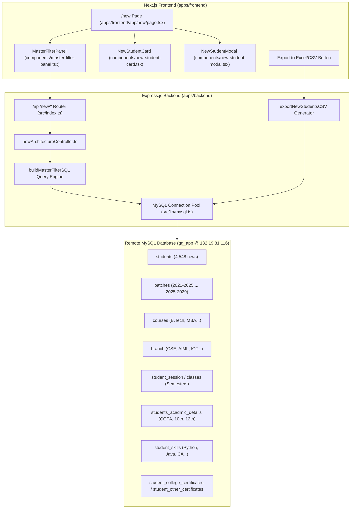

# Master Filtering Architecture & TPO Placement Portal Documentation

This document describes the design, implementation, and schema mappings of the **Master Filtering Architecture (Placement Candidate Engine)** and the **Excel/CSV Export System** for the Training & Placement Cell (TPO) Portal.

---

## 1. Executive Summary & Purpose

The TPO Portal previously relied on static Google Forms and Google Sheets. The new architecture directly queries the live **Gyan Ganga ERP MySQL Database (`gg_app`)** hosted on the college virtual machine (`182.19.81.116:3306`).

During campus recruitment drives, visiting companies (e.g., TCS, Infosys, Cisco, Wipro) impose strict and varying eligibility criteria:
* **Academic Thresholds**: Minimum CGPA (e.g., $\ge 7.0$), 10th Board % ($\ge 60\%$), 12th Board % ($\ge 65\%$).
* **Department Hierarchy**: Batch (e.g., `2024-2028`), Course (`B.Tech`), Multiple Branches (`CSE`, `AIML`, `IOT`), and Current Semester (`Sem V`).
* **Technical Skills**: Required proficiency in specific technologies (e.g., `Python`, `Java`, `SQL`).
* **Certifications**: Verified college academy certificates or recognized industry MOOCs.
* **Diversity & Reservation**: Gender-specific hiring drives or PSU reservation categories (`General`, `OBC`, `SC`, `ST`).

The **Master Filtering Architecture** provides a declarative, future-proof query system that supports all these parameters dynamically, displays live counts, and enables one-click **Excel / CSV export** for corporate HRs.

---

## 2. High-Level System Architecture



---

## 3. Database Schema & Relational Mapping

All data is queried from the `gg_app` database. Below is the mapping across the primary tables:

| Entity | Database Table | Columns Used | Description |
| :--- | :--- | :--- | :--- |
| **Student Core** | `students` | `id`, `roll_no`, `admission_no`, `firstname`, `lastname`, `email`, `mobileno`, `gender`, `dob`, `cast`, `father_name`, `father_phone`, `city`, `state` | Primary student biographical and contact record. |
| **Batch** | `batches` | `id`, `batchName` | Direct foreign key from `students.batchid = batches.id`. |
| **Course** | `courses` | `id`, `courseName` | Direct foreign key from `students.courseid = courses.id`. |
| **Current Class & Sem** | `student_session`, `classes`, `sections` | `student_session.student_id`, `classes.class`, `sections.section` | Resolved via `latest_ss` subquery matching the student's highest session ID. Semester is parsed via regex (`Sem I` to `Sem VIII`). |
| **Branch** | `branch` | `id`, `name`, `code` | Matched via class name string pattern (`cl.class LIKE %branch.name%`) and admission number code. |
| **Academic Details** | `students_acadmic_details` | `marks_10`, `marks_12`, `cgpa`, `sem_1` through `sem_8`, `ug` | `LEFT JOIN` on `student_id = students.id`. Gracefully defaults to `null` when rows are pending. |
| **Skills** | `student_skills` | `student_id`, `skill_name` | One-to-many relationship. Evaluated with `IN (?)` and `HAVING COUNT(DISTINCT skill_name)`. |
| **College Certificates** | `student_college_certificates` | `student_id`, `certificate_name`, `certificate_number`, `status`, `file_key` | Verified certifications issued by the institution. |
| **External Certificates** | `student_other_certificates` | `student_id`, `certificate_name`, `issuing_organization`, `credential_id`, `credential_url` | Self-uploaded external MOOCs and certifications. |

---

## 4. Backend Endpoints & Query Engine

All backend logic resides in [newArchitectureController.ts](file:///Users/shubhashishchakraborty/shubhworkspace/tpo_college_work/apps/backend/src/controllers/newArchitectureController.ts).

### 4.1 Filter Metadata Endpoint
* **Route**: `GET /api/new/filters-meta`
* **Response**:
  ```json
  {
    "success": true,
    "data": {
      "batches": [{ "id": 4, "name": "2024-2028", "studentCount": 401 }],
      "courses": [{ "id": 1, "name": "B.Tech" }],
      "branches": [{ "id": 1, "name": "Computer Science & Engineering", "code": "UC" }],
      "semesters": ["Sem I", "Sem II", "Sem III", "Sem IV", "Sem V", "Sem VI", "Sem VII", "Sem VIII"],
      "skills": ["C", "C#", "Java", "Java, .net", "Python", "SQL"],
      "genders": ["Male", "Female"],
      "categories": ["General", "OBC", "SC", "ST"]
    }
  }
  ```

### 4.2 Master Filter Students Endpoint
* **Route**: `GET /api/new/students`
* **Query Parameters Supported**:
  * `batch`: Single batch name (e.g. `2024-2028`) or comma-separated list.
  * `course`: Single course name (e.g. `B.Tech`).
  * `branch`: Comma-separated multi-branch list (e.g. `CSE,AIML,IOT`).
  * `semester`: Target semester (e.g. `Sem V`).
  * `minCgpa`: Floating point threshold (e.g. `7.5`).
  * `maxCgpa`: Floating point ceiling.
  * `min10th`: Minimum 10th Board % (e.g. `60`).
  * `min12th`: Minimum 12th Board % (e.g. `65`).
  * `skills`: Comma-separated skills (e.g. `Python,Java`).
  * `skillsMatch`: `'any'` (matches students with at least one skill) or `'all'` (matches students with all listed skills).
  * `hasVerifiedCert`: `'true'` or `'false'`.
  * `hasOtherCert`: `'true'` or `'false'`.
  * `gender`: `'Male'` or `'Female'`.
  * `category`: `'General'`, `'OBC'`, `'SC'`, `'ST'`.
  * `search`: Live search across Name, Enrollment No, Father Name, Email, and Mobile.
  * `page` & `limit`: Pagination parameters (default: 48 per page).

### 4.3 HR Excel / CSV Export Endpoint
* **Route**: `GET /api/new/export`
* **Features**:
  * Accepts the exact same query parameters as `/api/new/students`.
  * Queries up to 5,000 matching records without pagination capping.
  * Prepends the UTF-8 Byte Order Mark (`\uFEFF`) to guarantee immediate compatibility with Microsoft Excel without mojibake/character corruption.
  * Sets `Content-Disposition: attachment; filename="TPO_Students_<batch>_<timestamp>.csv"`.
  * Exports comprehensive columns:
    1. Roll No / Enrollment
    2. Admission No
    3. Full Name
    4. Course
    5. Branch
    6. Batch
    7. Semester
    8. Section
    9. CGPA
    10. 10th %
    11. 12th %
    12. Technical Skills
    13. Gender
    14. Category
    15. Mobile
    16. Email
    17. Father Name
    18. Father Phone
    19. City
    20. State

---

## 5. Frontend UI Components

The frontend is implemented in Next.js 16 with Tailwind CSS and Framer Motion:

1. **Master Filter Panel ([master-filter-panel.tsx](file:///Users/shubhashishchakraborty/shubhworkspace/tpo_college_work/apps/frontend/components/master-filter-panel.tsx))**:
   * Enterprise tabbed segment layout (`Cohort & Program`, `Branches`, `Academic Cutoffs`, `Skills & Certifications`).
   * Clean neutral slate surfaces, high-contrast readable typography (no small/cramped inputs).
   * Spacious branch grid with code badges and "Select All" / "Clear" buttons.
   * Unified academic cutoff inputs with instant preset buttons.
   * Interactive dark pill badges for technical skills with match mode toggle.
   * Active criteria strip with individual chip dismissal and "Clear all" link.
   * Executive dark "Export to Excel" button.
2. **Student Cards ([new-student-card.tsx](file:///Users/shubhashishchakraborty/shubhworkspace/tpo_college_work/apps/frontend/components/new-student-card.tsx))**:
   * Clean white enterprise card with subtle slate borders (removed artificial gradient movement).
   * 48px refined avatar with candidate initials.
   * Top right emerald CGPA badge (`7.85 CGPA`).
   * Branch, Semester, and Gender tags.
   * Skills badges and certificate counter.
   * "View Full Profile →" action footer with subtle hover transition.
3. **Student Profile Modal ([new-student-modal.tsx](file:///Users/shubhashishchakraborty/shubhworkspace/tpo_college_work/apps/frontend/components/new-student-modal.tsx))**:
   * Full modal popup with smooth spring animation.
   * Academic Performance card displaying CGPA, 10th Board %, 12th Board %, UG score, and Semester SGPA grid (Sem 1 to Sem 8).
   * Skills badges, verified college certificates with credential status, external certificates with verification URLs, and parent/contact details.

---

## 6. How to Run and Test Locally

### Step 1: Start Backend
```bash
cd apps/backend
pnpm dev
```
*(Runs on `http://localhost:3001` with connection pool connected to `182.19.81.116:3306`)*

### Step 2: Start Frontend
```bash
cd apps/frontend
pnpm dev
```
*(Runs on `http://localhost:3000`)*

### Step 3: Test Key Placement Scenarios
1. Open **`http://localhost:3000/new`** in your browser.
2. **Test Scenario A (Technical Skills Search)**:
   * In Section 3 (Technical Skills), click **Python** and **Java**.
   * Notice student **Yash Gupta (`0206CS241384`)** is immediately displayed with active skills.
3. **Test Scenario B (Academic Cutoff Filter)**:
   * Under Section 2 (Cutoffs), click **7.0+** CGPA or enter a custom score.
   * Notice real-time filtering through `students_acadmic_details`.
4. **Test Scenario C (Excel / CSV Export)**:
   * Select any filter combination (e.g., Batch `2024-2028` and Branch `Computer Science & Engineering`).
   * Click **Export to Excel / CSV**.
   * A clean CSV spreadsheet will download immediately formatted with full placement columns ready for HR distribution.

---

## 7. Future Extension Guidelines

To add additional criteria (e.g., number of active backlogs, gap years, or internships):
1. **Backend**: Add the column condition to `buildMasterFilterSQL` inside [newArchitectureController.ts](file:///Users/shubhashishchakraborty/shubhworkspace/tpo_college_work/apps/backend/src/controllers/newArchitectureController.ts). Because `students_acadmic_details` and `students` are joined via `LEFT JOIN`, adding new numeric or categorical conditions will not break existing records.
2. **Frontend**: Add the filter key to `MasterFilterState` in [student-v2.ts](file:///Users/shubhashishchakraborty/shubhworkspace/tpo_college_work/apps/frontend/types/student-v2.ts) and render its input in [master-filter-panel.tsx](file:///Users/shubhashishchakraborty/shubhworkspace/tpo_college_work/apps/frontend/components/master-filter-panel.tsx).
